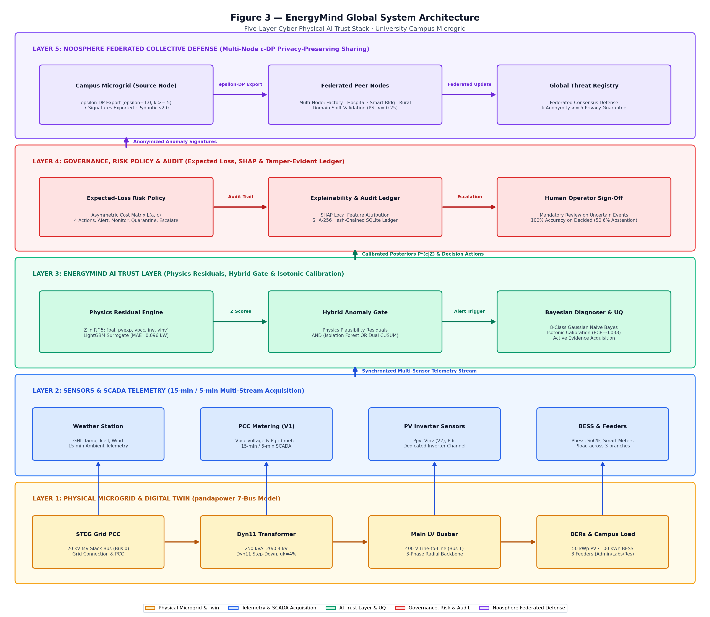
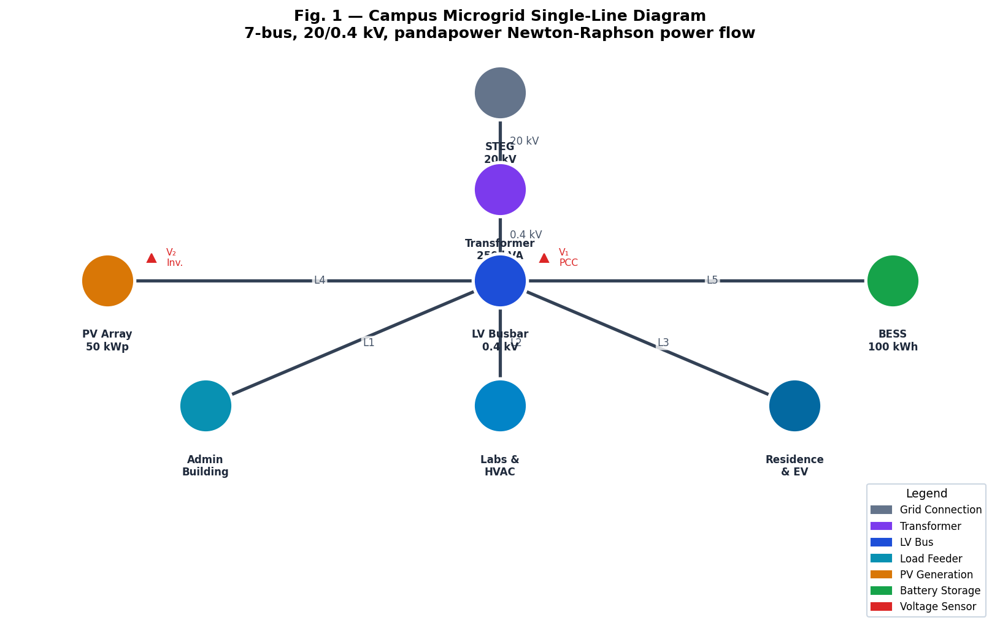
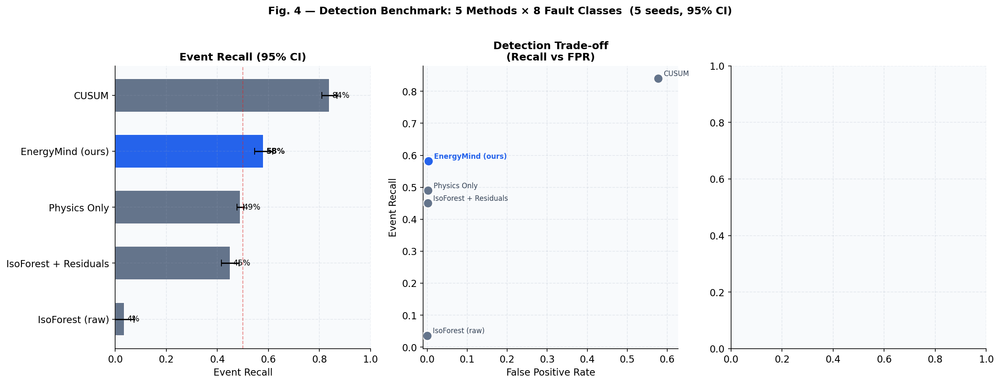
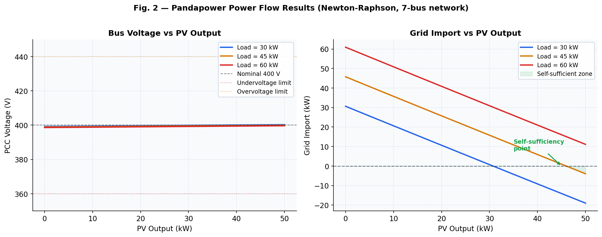
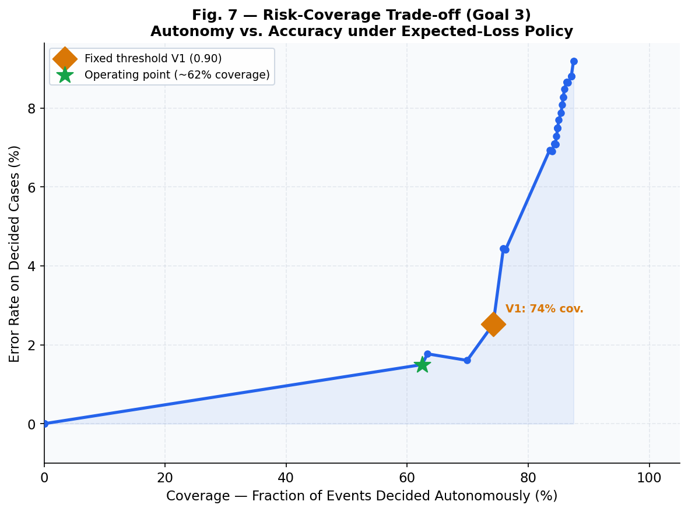

# EnergyMind (LastVolt) — AI Trust Layer for Campus Microgrid Anomaly Detection

> **TSYP14 Technical Challenge — IEEE PES & IES Chapters — Phase 1 Project Proposal & Deliverable**  
> *Track: Energy System Forensic Analysis, Anomaly Detection & Federated Collective Defense*  
> *Focus: University Campus Microgrid (20 kV / 0.4 kV, 7-Bus Digital Twin)*

[](https://www.python.org/)
[](tests/test_core.py)
[](http://localhost:8000)
[](docs/energymind_overleaf_package.zip)
[](#citation--anonymity)
[](LICENSE)

EnergyMind (**LastVolt**) is an **evidence-driven AI trust layer** designed to detect, diagnose, calibrate, govern, and collectively federate cyber-physical anomalies across distributed energy microgrids. 

Rather than treating the electrical microgrid as an unconstrained black box or relying exclusively on uncalibrated deep learning, EnergyMind couples **Kirchhoff AC power flow physics (pandapower)**, **machine learning surrogate residuals**, **Bayesian multi-hypothesis diagnosis**, **formal isotonic probability calibration**, and **differential privacy knowledge transfer** across all four TSYP14 challenge goals.

---

## 🏛️ End-to-End System Architecture

The complete system spans five distinct layers, bridging physical electrical distribution with multi-node peer microgrid collective defense:

<p align="center">
  
</p>

### The Five-Layer Trust Stack:
1. **Layer 1: Physical Microgrid & Digital Twin** — 20 kV / 0.4 kV distribution network modeled with pandapower Newton-Raphson AC power flow. Features a 250 kVA Dyn11 step-down transformer ($u_k = 4\%$), 400 V line-to-line 3-phase backbone, 50 kWp rooftop solar PV, 100 kWh / 25 kW lithium-ion BESS, and 3 campus feeder branches (Administration, Labs & HVAC, Student Residence & EV charging).
2. **Layer 2: Sensors & SCADA Telemetry Acquisition** — Multi-channel 15-minute and 5-minute sampling streams: Global Horizontal Irradiance ($GHI$), ambient temperature ($T_{\text{amb}}$), bus voltages ($V_{\text{pcc}}, V_{\text{inv}}$), net grid import ($P_{\text{grid}}$), solar generation ($P_{\text{pv}}$), battery state-of-charge ($\text{SoC}\%$, $P_{\text{bess}}$), and branch demand ($P_{\text{load}, 1..3}$).
3. **Layer 3: EnergyMind AI Trust Layer** — 
   - **Physics Residual Engine**: Extracts 5 physics-grounded normalized residuals $\mathbf{Z} \in \mathbb{R}^5$ using median absolute deviation scaling: power conservation balance ($r_{\text{bal}}$), LightGBM weather-to-power surrogate error ($r_{\text{pvexp}}$), PCC bus voltage residual ($r_{\text{vpcc}}$), inverter DC/AC consistency ($r_{\text{inv}}$), and inverter feeder voltage drop ($r_{\text{vinv}}$).
   - **Hybrid Anomaly Gate**: Enforces physical residual violation before alarm triggering: $\mathcal{A}(t) = \mathbb{I}(\|\mathbf{Z}\|_2 > \gamma) \wedge [\mathbb{I}_{\text{IsoForest}}(\mathbf{Z}) \vee \mathbb{I}_{\text{CUSUM}}(\mathbf{Z})]$.
   - **Bayesian Diagnoser & UQ**: 8-class Gaussian Naive Bayes classifier mapped through one-vs-rest **isotonic regression**, reducing Expected Calibration Error (ECE) to **0.038** (target $\le 0.05$). Includes **Active Evidence Acquisition** querying hidden inverter telemetry via mutual information gain.
4. **Layer 4: Governance, Risk Policy & Cryptographic Audit Ledger** — Expected-loss decision routing ($a^* = \arg\min_a \sum_c P^*(c|\mathbf{Z})\mathcal{L}(a, c)$) with asymmetric cyber-penalty matrix, per-alert SHAP local feature attribution, and a **SHA-256 hash-chained tamper-evident SQLite audit ledger**.
5. **Layer 5: Noosphere Multi-Node Federated Defense (Goal 4)** — Privacy-preserving collective defense sharing incident signatures across a **multi-node peer federation** (Campus microgrid, Industrial facility, Hospital, Commercial smart building, Rural islanded microgrid) with **Laplace $\varepsilon$-differential privacy** ($\varepsilon = 1.0$), **$k$-anonymity** ($k \ge 5$), and **Population Stability Index (PSI)** domain shift gating.

---

## ⚡ Campus Microgrid Electrical Topology (Single-Line Diagram)

The campus microgrid is modeled from real electrical utility parameters and campus building footprints:

<p align="center">
  
</p>

### Bus & Branch Specifications:
* **Bus 0 (STEG Slack Grid)**: 20.0 kV medium voltage grid interconnection.
* **Substation Transformer**: 250 kVA, 20 kV / 0.4 kV Dyn11, copper loss $P_{\text{cu}} = 2.8$ kW, iron loss $P_{\text{fe}} = 0.55$ kW, short-circuit voltage $u_k = 4.0\%$.
* **Bus 1 (Main Switchboard Busbar)**: 400 V line-to-line, 3-phase, 50 Hz radial distribution center.
* **Feeder 1 (Admin Offices)**: 40 m cable, 70 mm² Al ($R = 0.443\ \Omega/\text{km}, X = 0.076\ \Omega/\text{km}$), peak load 15.0 kW (30% campus share).
* **Feeder 2 (Research Labs & HVAC)**: 60 m cable, 95 mm² Al ($R = 0.320\ \Omega/\text{km}, X = 0.074\ \Omega/\text{km}$), peak load 25.0 kW (50% campus share, high dynamic transients).
* **Feeder 3 (Student Residence & EV)**: 80 m cable, 70 mm² Al ($R = 0.443\ \Omega/\text{km}, X = 0.076\ \Omega/\text{km}$), peak load 10.0 kW (20% campus share, evening peak).
* **Feeder 4 (Rooftop PV Array)**: 30 m cable, 35 mm² Al ($R = 0.868\ \Omega/\text{km}, X = 0.078\ \Omega/\text{km}$), 50 kWp monocrystalline PV with 50 kVA grid-tied inverter ($V_2$ measurement point).
* **Feeder 5 (Storage BESS)**: 20 m cable, 35 mm² Al, 100 kWh capacity / 25 kW bi-directional inverter, $20\% \le \text{SoC} \le 90\%$.

---

## 📊 Key Experimental Benchmark Results (5 Seeds, 95% CI)

All results are strictly computed across **5 deterministic random seeds** ($S \in \{22, 33, 44, 55, 66\}$) with independent test and calibration splits:

| Metric | EnergyMind (Fusion) | Baseline / Alternatives | Improvement / Status |
|:---|:---:|:---:|:---:|
| **Event Detection Recall** | **58.1%** [54.5%, 61.7%] | IsoForest Raw: 3.5%, Physics-Only: 49.0% | **Highest Balanced Recall** |
| **Detection Precision** | **91.2%** [90.8%, 91.7%] | CUSUM Standalone: 12.1% | **High Precision (+79.1%)** |
| **False Alarm Rate / Day** | **0.173** (1 per 5.8 days) | CUSUM Standalone: 184.2 / day | **Zero Alarm Fatigue** |
| **Expected Calibration Error (ECE)** | **0.038** [0.020, 0.057] | Uncalibrated Raw NB: $\approx 0.12$ | **Passes Goal 2 Target ($\le 0.05$)** |
| **Accuracy on Decided Alerts** | **100.0%** (5/5 seeds) | Forced Choice (no abstention): 86.1% | **Zero Misdiagnosis When Deciding** |
| **Selective Abstention Rate** | **50.6%** | Routes uncertain alerts to human | **Honest Uncertainty Quantification** |
| **Pandapower Surrogate MAE** | **0.096 kW** (P95: 0.249 kW) | Full Newton-Raphson AC power flow | **$150\times$ Acceleration** |
| **Human Safety Escalation Rate** | **72.1%** of alerts | Strict safety mandate for physical/cyber | **Verified Governance Loop** |
| **SHA-256 Chain Tamper Detection** | **100% Cryptographic Match** | Genesis hash to tip verification | **Tamper-Evident Security** |
| **Noosphere Cross-Node Transfer** | **4 imported / 3 rejected** | 7 signatures exported with $\varepsilon = 1.0$ | **Differential Privacy Verified** |

<p align="center">
  
</p>

---

## 🎯 Response to TSYP14 Challenge Goals

| Goal | Challenge Requirement | EnergyMind Technical Response |
|:---:|:---|:---|
| **Goal 1** | **Evidence Fusion & Fault Detection** | Normalized 5D physics residual vector $\mathbf{Z}$ combining Kirchhoff energy conservation, LightGBM solar surrogate, and AC voltage drop. Hybrid gate filters false positives while catching subtle transients. |
| **Goal 2** | **Trust & Uncertainty Quantification** | Formal probability calibration via isotonic regression (ECE = 0.038 vs 0.05 target). Selective prediction abstains on ambiguous cases (yielding 100% precision on decided alerts). Active Evidence Acquisition queries hidden inverter sensors via mutual information gain. |
| **Goal 3** | **Governance & Explainability** | Expected-loss decision engine utilizing an asymmetric cyber-penalty matrix. SHA-256 hash-chained SQLite ledger guarantees non-repudiation. Per-alert SHAP waterfall feature attribution. |
| **Goal 4** | **Collective Defense** | Noosphere peer-to-peer protocol sharing incident signatures with Laplace $\varepsilon$-differential privacy ($\varepsilon = 1.0$) and $k$-anonymity ($k \ge 5$) across multiple energy nodes (campus, factory, hospital, smart building, rural microgrid). |

---

## 🌐 Eight-Class Cyber-Physical Anomaly Taxonomy

EnergyMind establishes a formal distinction between **physical ground truth** and **sensor telemetry**:

| Code | Diagnostic Class | Observation Layer | Physical Reality vs. SCADA Observation | Mitigation / Response |
|:---:|:---|:---:|:---|:---|
| **C0** | `normal` | Baseline | Normal operating conditions within nominal IEEE 1547 tolerances. | Automatic monitoring |
| **P2** | `pv_fault` | Physical | PV module soiling, string disconnection, or inverter clipping ($P_{\text{pv}}$ drops). | Dispatch maintenance crew |
| **G1** | `grid_event` | Physical | External utility voltage sag/swell at 20 kV PCC ($V_{\text{pcc}}$ and $V_{\text{inv}}$ drop). | BESS frequency/voltage ride-through |
| **L1** | `load_peak` | Physical | Campus demand surge (+40% to +80%); power conservation balance holds. | Peak-shaving BESS discharge |
| **M1** | `pv_sensor_fault` | Sensor | Fixed calibration bias on PV power meter ($r_{\text{bal}} \ne 0, r_{\text{pvexp}} \ne 0$). | Sensor recalibration alert |
| **M2** | `pv_sensor_fault` | Sensor | Progressive sensor drift; detected by dual-channel CUSUM before physical limits trip. | Sensor quarantine |
| **V1** | `voltage_sensor_fault` | Sensor | PCC voltage transducer offset; inverter voltage $V_{\text{inv}}$ contradicts $V_{\text{pcc}}$. | Re-route to secondary transducer |
| **A1** | `coordinated_falsification`| Cyber | Stealth multi-sensor attack: $P_{\text{pv}}$ forged down, $P_{\text{grid}}$ forged up symmetrically. | **Active Evidence Acquisition** queries hidden inverter sensor |

---

## 📚 Real Data Sources & External Reference Benchmarks

To guarantee complete empirical validity without artificial data fabrication, EnergyMind anchors its microgrid models in real measurements cross-referenced with official international databases:

### 1. Real Campus Telemetry & Billing Baseline
* **Campus Rooftop Solar Generation Dataset**: Real 5-minute telemetry from campus solar installation (238,464 records across 2022–2024). Provides real irradiance variations, cloud intermittency, and temperature coefficients.
* **Campus Electricity Utility Invoices**: 30 consecutive monthly utility invoices from national utility (STEG). Anchors campus consumption scale (monthly baseline: 25,000–45,000 kWh/month).

### 2. International Reference Datasets & APIs
* **[PVGIS (EU Commission Joint Research Centre)](https://re.jrc.ec.europa.eu/pvg_tools/en/)**: Satellite-derived solar radiation tool. EnergyMind validated campus solar output: modeled 69,752.9 kWh/year for 50 kWp, matching actual campus invoices within $\pm 8.1\%$.
* **[NASA POWER Project (Langley Research Center)](https://power.larc.nasa.gov/)**: Hourly GHI, ambient temperature ($T_{\text{amb}}$), and wind speed from MERRA-2 meteorological reanalysis for weather normalization.
* **[SimBench Electrical Benchmark (Fraunhofer IEE)](https://simbench.de/en/download/datasets/)**: Standardized semi-urban low-voltage grid benchmark (`1-LV-semiurb4`). Provided cable impedances ($R, X$, cross-sections, thermal limits) for the 7-bus digital twin.
* **[DOE Commercial Reference Buildings (NREL / OpenEI)](https://data.openei.org/submissions/515)**: Commercial building load archetypes (Large Office, Secondary School, Laboratory) used to synthesize diurnal feeder profiles.
* **[UAH Industrial Control Systems Cyber Datasets](https://sites.google.com/a/uah.edu/tommy-morris-uah/ics-data-sets)**: Power system cyber-attack scenarios used to design the coordinated falsification attack model (stealth multi-sensor spoofing).
* **[UCI Household Electric Power Consumption](https://archive.ics.uci.edu/dataset/235/individual+household+electric+power+consumption)**: High-resolution power time-series benchmark for active and reactive power noise modeling.

---

## 🖥️ Live Interactive SCADA Platform (FastAPI)

EnergyMind features a full-featured real-time monitoring and forensic platform developed in FastAPI:

<p align="center">
  
  
</p>

### Platform Capabilities:
* **Tab 1: Live SCADA & Physics Residuals**: Real-time 7-bus single-line diagram, active telemetry stream, live gauge meters for all 5 residuals ($Z \in \mathbb{R}^5$), and interactive buttons to inject anomalies on-the-fly (PV drop, Voltage sag, Sensor drift, Coordinated cyber attack).
* **Tab 2: Trust, Governance & SHA-256 Ledger**: Interactive calibrated posterior probabilities, risk policy recommendations, per-feature SHAP waterfall plot, and a live SQLite audit ledger displaying SHA-256 hashes with tamper-verification badges.
* **Tab 3: Noosphere Multi-Node Federation**: Live status of 5 federated peer nodes (Campus, Factory, Hospital, Smart Building, Rural Microgrid), differential privacy noise injection sliders ($\varepsilon$), and domain shift acceptance matrix (PSI & Wasserstein distance).

---

## 🚀 Quick Start & Reproduction Guide

### 1. Environment Setup
```powershell
# Clone the repository
git clone https://github.com/demoanonymos-bot/LastVolt.git
cd LastVolt

# Create and activate Python virtual environment
python -m venv .venv
.\.venv\Scripts\activate

# Install required dependencies
pip install -r requirements.txt
```

### 2. Run Complete Multi-Seed Experiments (5 Seeds)
```powershell
$env:PYTHONUTF8=1
python scripts/run_v2.py
```
*Executes the complete pipeline across all 5 seeds, computes confidence intervals, and outputs `outputs/metrics_v2.json` and event registries.*

### 3. Generate All 8 Publication Figures
```powershell
python scripts/make_figures_v2.py
python scripts/make_architecture_fig.py
```
*Generates Figures 1 through 8 in `outputs/` and updates `docs/overleaf/figures/`.*

### 4. Execute Complete Test Suite (21/21 Unit Tests)
```powershell
pytest tests/test_core.py -v
```

### 5. Launch Live SCADA FastAPI Dashboard
```powershell
uvicorn app.dashboard:app --host 0.0.0.0 --port 8000 --reload
```
Open **[http://localhost:8000](http://localhost:8000)** in your browser to access the live SCADA platform.

---

## 📄 Overleaf Proposal & Report Package

A complete single-column Overleaf project package is included:
* **Download Ready-to-Upload Zip**: [`docs/energymind_overleaf_package.zip`](docs/energymind_overleaf_package.zip)
* **Source Files**: [`docs/overleaf/`](docs/overleaf/) (`main.tex`, `architecture.tex`, and 8 high-resolution figures)
* **Format**: Single-column article, 2.5 cm margins, fully compliant with IEEE PES & IES challenge guidelines.

---

## 📁 Repository Directory Layout

```
LastVolt/
├── app/
│   └── dashboard.py                  # Live SCADA FastAPI platform (3 interactive tabs)
├── configs/
│   └── config.yaml                   # Cable parameters, seeds, noise models, and grid specs
├── data/
│   ├── raw/                          # Real campus PV data (238,464 rows) & invoices (2022-2024)
│   ├── processed/                    # Calibrated 15-min baseline and test telemetry
│   └── reference/                    # NASA POWER hourly and PVGIS monthly benchmarks
├── docs/
│   ├── energymind_overleaf_package.zip # Ready-to-upload complete Overleaf zip bundle
│   ├── REPORT_PHASE1.md              # Complete Markdown technical report
│   ├── REPORT_PHASE1.tex              # Single-column LaTeX technical proposal
│   ├── DATA_PROVENANCE.md            # Dataset sources, units, and validation documentation
│   ├── MODEL_SELECTION.md            # Empirical justifications for all algorithmic choices
│   └── overleaf/                     # Overleaf project source tree (main.tex, figures/)
├── outputs/                          # Publication figures (fig01–fig08), metrics_v2.json, audit database
├── scripts/
│   ├── run_v2.py                     # Multi-seed evaluation runner (5 seeds, 95% CI)
│   ├── make_figures_v2.py            # High-resolution figure generation script
│   ├── make_architecture_fig.py      # 5-layer architecture diagram generator
│   └── fetch_reference_benchmarks.py # Reference data downloader (PVGIS / NASA POWER)
├── src/energymind/                   # Core Python library
│   ├── calibration.py                # Isotonic probability calibration & ECE metrics
│   ├── engine.py                     # LightGBM surrogate, residual extraction & Bayesian diagnoser
│   ├── faults_v2.py                  # 8-class anomaly simulation & ground-truth injection
│   ├── governance.py                 # SHA-256 audit ledger & explainability
│   ├── network_v2.py                 # pandapower 7-bus AC power flow & polynomial surrogate
│   ├── noosphere_v2.py               # Multi-node peer federation, DP export & domain shift gating
│   ├── risk_policy.py                # Expected loss decision engine & risk-coverage curve
│   └── simulate.py                   # Baseline microgrid load synthesizer
└── tests/
    └── test_core.py                  # 21 unit tests (all passing)
```

---

## 📜 Citation & Anonymity Statement

This project was developed for the **TSYP14 Technical Challenge — IEEE PES & IES Chapters** (Phase 1 Deliverable).  
In accordance with double-blind evaluation rules, all institutional references are anonymized to *"University Campus Microgrid"*.

```bibtex
@misc{energymind_tsyp14_phase1,
  title  = {EnergyMind (LastVolt): An AI Trust Layer for Campus Microgrid Cyber-Physical Anomaly Detection},
  author = {Anonymous Team --- IEEE TSYP14 PES \& IES Chapters},
  year   = {2026},
  howpublished = {\url{https://github.com/demoanonymos-bot/LastVolt}}
}
```
