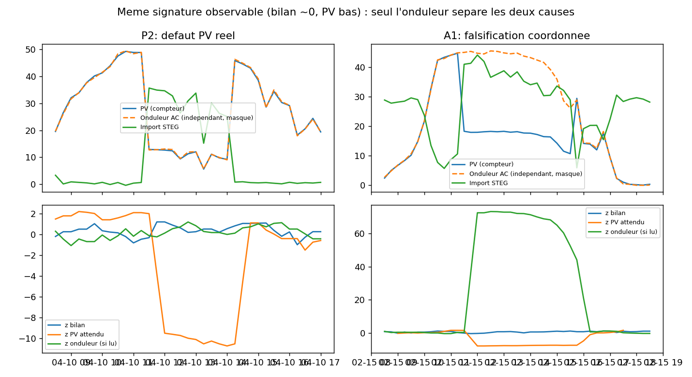
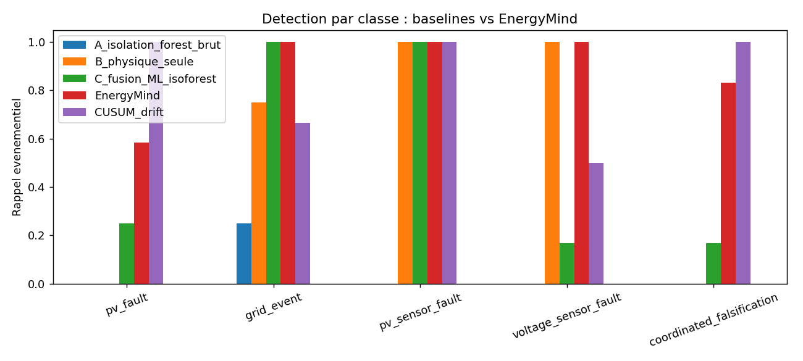

# 1. Positioning

EnergyMind is not an anomaly detector. It is a **trust-assurance layer** that sits between raw measurements of a campus microgrid and any automated action. For each suspicious event it answers four questions: *what is observed, which hypotheses explain it, which evidence supports or contradicts each, and which missing check would settle it.* When the evidence cannot separate two causes, the system **abstains and says which measurement to read next**.

**Research question.** How can an AI separate physical events from measurement corruption in a partially observable microgrid, quantify the limits of its own diagnosis, call the operator when needed, and transfer validated knowledge to other energy environments?

# 2. Scope

| Item | Choice |
|---|---|
| Layer | **Microgrid** — Campus Universitaire campus connected to the STEG grid (PCC) |
| Assets | PV plant, campus load, BESS (virtual), PCC meter, inverter telemetry, two voltage points |
| Real data (Phase 1) | PV/weather series 5-min, 2022-02-24 → 2024-05-31 (238,464 rows); Campus Universitaire monthly invoices 2022–2024 |
| Virtual / simulated | BESS, inverter telemetry, voltage, intra-month load profile, all faults |
| Phase 2 | Replace assumptions with the technical director's measured data (every parameter in `configs/config.yaml` carries a provenance status) |

# 3. Objectives

1. Detect equipment faults, degraded/biased sensors, falsified readings and genuine grid events, **and distinguish genuine events from data-quality problems**.
2. Output a calibrated confidence, a plain-language explanation and a tamper-evident decision log for every flag.
3. Define what the AI may do alone and what requires a human, with an operator interface; address over-trust and under-trust.
4. Specify and prototype knowledge sharing across nodes with explicit privacy rules.
5. Demonstrate, by controlled experiments, where the architecture beats baselines **and where it must abstain**.

# 4. Data and anomaly-simulation plan

## 4.1 Baseline construction (all steps traced, nothing silently merged)

* **PV:** the supplied series is resampled to 15 min and normalised by its 99.9th percentile, then scaled to an assumed installed capacity (50 kWp, *simulation assumption*). The maximum of the series is **not** assumed to be nameplate power; the unit of `Power` is to be confirmed.
* **Load:** a public/parametric intra-month profile $w(t)$ (weekday/weekend occupancy + AR(1) noise) is normalised so each month matches the invoiced energy: $P_{load}(t)=E_{month}\,w(t)/\sum_{month} w\,\Delta t$. The intra-month shape is a hypothesis; it is flagged as such.
* **BESS:** 100 kWh / 40 kW, 95 % one-way efficiency, SOC 10–90 %, self-consumption dispatch (*simulation assumption*).
* **Network:** loss model, 400 V nominal, two voltage measurement points. The simulator conserves energy (max balance error 1e-14 kW, unit-tested).

## 4.2 Data-quality findings on the real files (reproducible: `outputs/invoice_quality_log.csv`)

* Invoices: 3 mislabeled months re-assigned by chronological sequence (08/2022→08/2023, 09/2022→09/2023, 05/2022→05/2024), 1 orphan total, 2 missing months (11–12/2022), 3 implausible rows (09/2023, 10/2023, 05/2024). Invalid months are imputed by seasonal median and flagged `imputed`. **All to be confirmed with the technical director.**
* PV: no missing timestamps or NaN; 2.3 % of night samples have non-zero power (to investigate).

## 4.3 Fault-injection catalogue

Physical truth and observed telemetry are separated: faults are injected either in the **physical state** (real events) or in the **measurement** (corruption), then noise is added. Every injected window is stored in a registry.

| ID | Scenario | Intervention | Class |
|---|---|---|---|
| P1 | Natural solar variation | none (already in real data) | normal |
| P2 | PV fault / curtailment | real PV ×0.25–0.65, grid compensates | pv_fault |
| G1 | Voltage sag (real) | both voltage points −8…−18 % | grid_event |
| M1 | PV sensor bias | metered PV ×0.35–0.7, physics unchanged | pv_sensor_fault |
| M2 | PV sensor drift | progressive bias over 6–12 h | pv_sensor_fault |
| V1 | Voltage sensor fault | one voltage point drops, other unchanged | voltage_sensor_fault |
| A1 | Coordinated falsification | PV lowered and grid raised by the same amount: **power balance stays consistent** | coordinated_falsification |

Splits are **chronological**: PV-model training 2022-02→2023-03; diagnosis calibration 2023-04→2023-10 (seed 11); test 2023-11→2024-05 (seed 22, 72 events).

# 5. Design per challenge goal

## Goal 1 — Anomaly & bias detection ("Evidence-Driven Energy Forensics")

Five interpretable evidence channels, each a robust z-score: power-balance residual (Kirchhoff), PV measured vs. irradiance-based expectation (gradient-boosted model), inverter AC vs. PV meter (independent), and voltage deviation at the PCC and at the inverter. A physics-structured Bayesian model gives a posterior over six hypotheses; missing measurements are *marginalised*, not imputed. An alert needs 3 consecutive anomalous steps.

*Key insight:* P2 (real PV fault) and A1 (coordinated falsification) produce the **same** balance and PV deviation. They are separable only with an independent measurement (inverter). EnergyMind recognises this identifiability limit instead of guessing (Fig. 1).

## Goal 2 — Confidence and explainability

Each flag gives: calibrated posterior, ranked competing hypotheses, the three evidence channels that weigh most (log-likelihood contributions — exact for this model, no post-hoc SHAP approximation needed), a plain-language verdict, and a **next-best-check** chosen by expected information gain minus cost, $U(m)=\mathbb{E}[\Delta H\mid m]-\lambda\,\mathrm{cost}(m)$. Every decision is appended to a SHA-256 hash-chained SQLite audit log (model version, evidence, posterior, proposed action, validator, justification); tampering is detected (unit-tested).

## Goal 3 — Human-AI escalation and governance

| Situation | Rule |
|---|---|
| Posterior < 0.90 | **Abstain → human review**, with the next-best-check |
| Sensor fault, posterior ≥ 0.95 | Automatic: quarantine the channel + alert (data-trust action only) |
| …of which 5 % | Random audit sample sent to a human (counters **over-trust**) |
| Real PV fault or grid event | Human decision required (recommendation only) |
| Coordinated falsification | Human + security escalation, always |
| Any physical grid action | **Out of scope** of the prototype |

Counter-measures for **under-trust**: the operator always sees the competing hypothesis, the evidence weights and measured calibration (ECE), so the AI's advice can be verified rather than blindly accepted or ignored. Operator UI (Streamlit): incident view, explanation, approve/reject/override with mandatory justification.

## Goal 4 — Shared learning across the noosphere

*Shared:* normalised incident signatures (mean/spread of residuals in sigma units), required sensors, validity conditions, limits — with Laplace noise and a k-anonymity floor (no class shared with < 5 events). *Kept local:* raw time series, load profiles, invoices, exact topology, validator identities (reason: commercial and personal-consumption privacy; raw series are also not transferable because each node has its own noise level). *Import:* a receiving node rejects a signature whose required sensors it lacks or that has no human validation, otherwise blends it with local knowledge by weighted shrinkage. Every incident carries a transferability sheet. The same contract is specialised for a factory line, a smart-metered neighbourhood and a simulated AC grid (constraint engine rewritten per domain). Phase 2 will validate transfer on a second simulated node with a different configuration; the three other domains remain documented design.

# 6. Phase 1 results (`outputs/metrics.json`, reproducible with one command)

Test period, 72 injected events, 20 k steps, inverter telemetry **hidden**:

| Method | Event recall | Step precision | Step recall | FPR |
|---|---|---|---|---|
| A. Isolation Forest on raw telemetry | 4 % | 0.84 | 0.03 | 0.03 % |
| B. Physics constraints only | 63 % | 0.89 | 0.55 | 0.42 % |
| C. ML fusion (Isolation Forest on residuals) | 60 % | 0.87 | 0.40 | 0.41 % |
| **EnergyMind** | **90 %** | 0.89 | 0.70 | 0.57 % |

* Physics-only detects 0 % of P2 and A1, because those events keep the balance consistent — confirming the need to combine physics and expectation models.
* Diagnosis on 65 detected events: forced accuracy 87.7 % (same as a supervised random forest, which gives no uncertainty). EnergyMind **abstains on 26 %**; accuracy on the 48 decided events is 100 %, calibration error ≈ 0.001.
* All 17 abstentions are P2/A1 confusions; the next-best-check selected the inverter reading each time, and after reading it accuracy on these events rises from 53 % to 100 %.
* Fig. 1: same alert, two causes. Fig. 2: recall by class.

{width=90%}

{width=80%}

**Honest limitations.** (i) The false-alarm rate (≈0.29 alert episodes/day) is too high for operations and will be reduced in Phase 2 (hysteresis, adaptive thresholds, mixed-class rejection). (ii) The generator that creates faults also calibrates the model, so results are optimistic until validated on measured faults; small sample (≈12 events/class). (iii) Perfect accuracy on 17 and 48 events is not a guarantee: confidence intervals will be added. (iv) Out-of-distribution events currently map to the closest known class; an explicit "unknown" class is planned.

# 7. Phase 2 plan

Replace assumptions with measured data (PV nameplate and unit, BESS, inverter and PCC telemetry); BESS-fault scenarios; false-alarm reduction; second simulated node and transfer experiment; pandapower AC power flow for network constraints; FastAPI service; full report, demo video, 5-minute pitch.

# 8. Business scope (bonus criterion)

| Item | Estimate (to validate) |
|---|---|
| Software | Open-source stack (Python, scikit-learn, SQLite/PostgreSQL, Streamlit/FastAPI): licence cost 0 |
| Edge deployment | One industrial mini-PC / gateway per site, reading existing meters over Modbus: order of 1–3 k TND per node |
| Integration | 2–4 engineer-weeks per site to map sensors and calibrate; Docker image for repeatable deployment |
| Continuous training | Monthly recalibration job; human-validated incidents feed the signature library |
| Value | Avoided billing/energy loss from undetected sensor bias, faster fault diagnosis, auditable decisions |

*All cost figures are planning assumptions, not quotes.*

# 9. Reproducibility

`pip install -r requirements.txt && python scripts/run_experiments.py && pytest` regenerates every number and figure in this document. Seeds, chronological splits, provenance statuses and the event registries are versioned in the repository.
